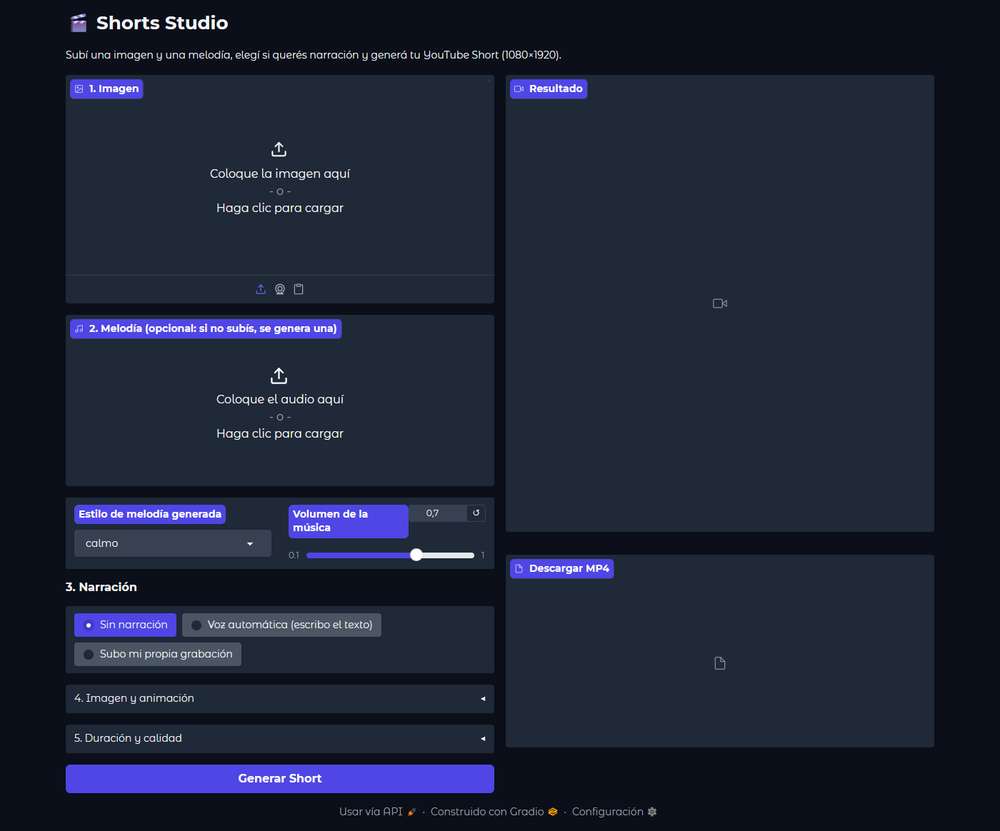
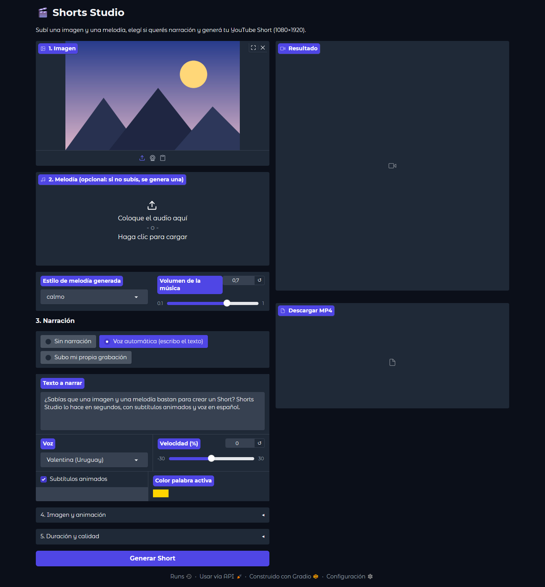
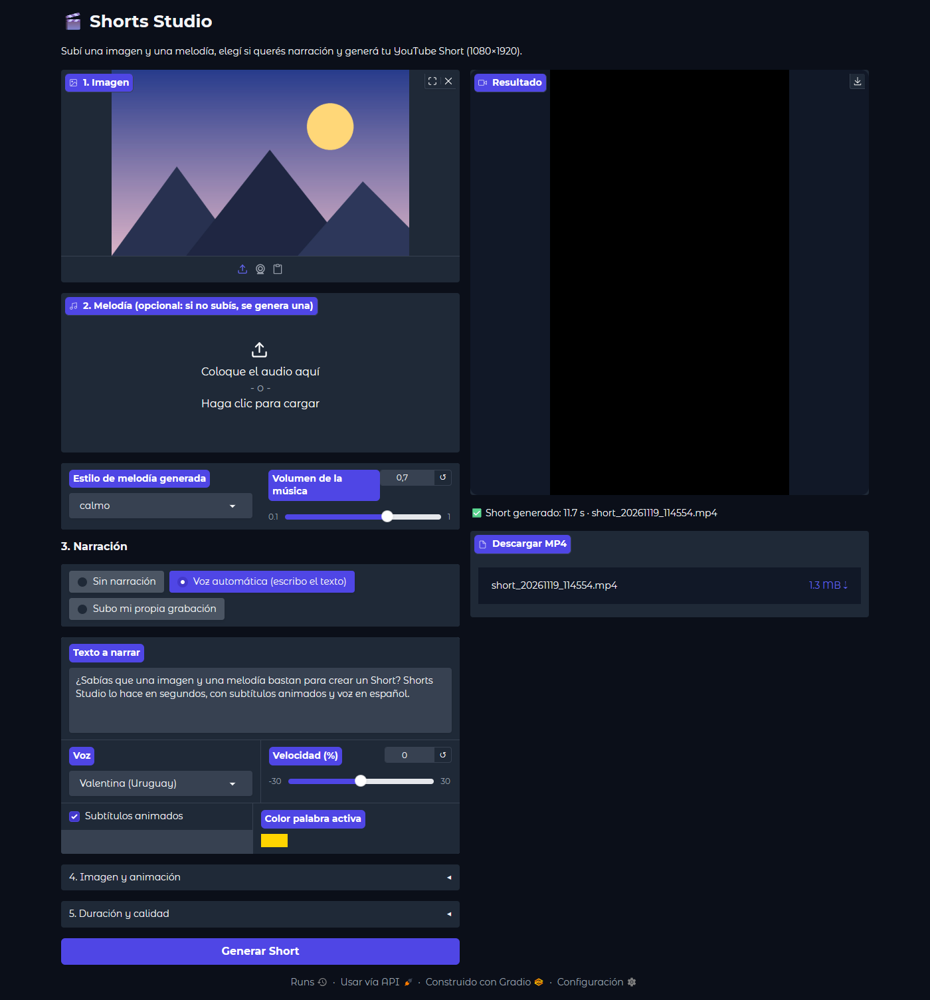
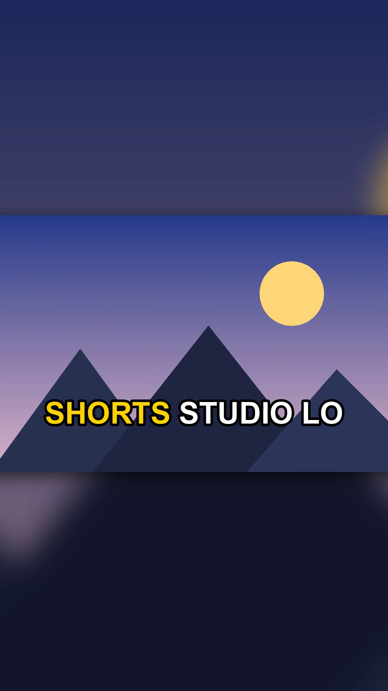

# 🎬 Shorts Studio (v0.2)

Aplicación web local para crear **YouTube Shorts** a partir de:

1. **Una imagen**
2. **Una melodía** (opcional: si no subís ninguna, se genera una original)
3. **Narración opcional**: voz automática a partir de un texto, o tu propia grabación

Resultado: MP4 vertical 1080×1920, H.264 + AAC, con volumen normalizado a −14 LUFS (el nivel de referencia de YouTube).

Todo es **gratis**: Python, FFmpeg, Gradio y Edge-TTS (voces neuronales de Microsoft, sin API key).

## Capturas

| Interfaz | Narración automática |
|---|---|
|  |  |

| Resultado en la app | Frame del Short generado (1080×1920) |
|---|---|
|  |  |

Short de ejemplo generado con la propia app (imagen + voz automática + subtítulos animados): [docs/demo/ejemplo.mp4](docs/demo/ejemplo.mp4)

## Instalación y uso (WSL Ubuntu)

```bash
cd shorts-studio
chmod +x iniciar.sh
./iniciar.sh          # la primera vez instala todo; después solo abre la app
```

Abrí **http://localhost:7860** en el navegador de Windows.

Instalación manual, si preferís:
```bash
sudo apt install ffmpeg python3-venv
python3 -m venv .venv && source .venv/bin/activate
pip install -r requirements.txt
python app.py
```

Los videos se guardan en la carpeta `salidas/`.

## Funciones

| Área | Qué hace |
|---|---|
| **Animación** | Ken Burns, zoom de acercamiento o alejamiento, paneo en 4 direcciones, pulso. Movimiento suave con coordenadas decimales |
| **Ajuste** | Imagen completa sobre fondo desenfocado, o recorte para llenar el 9:16 |
| **Narración automática** | 12 voces en español (Uruguay, Argentina, México, Colombia, España) e inglés, con velocidad regulable. Se puede escribir cualquier otra voz de `edge-tts --list-voices` |
| **Subtítulos** | Palabra por palabra, en bloques cortos, con la palabra activa resaltada y animación "pop". Ubicados lejos de los botones de Shorts |
| **Mezcla de audio** | La música baja automáticamente mientras habla la voz (*ducking*) y vuelve a subir en las pausas |
| **Duración** | Con narración se ajusta sola al largo de la voz. Sin narración se elige (5–60 s) |
| **Calidad** | 30 o 60 fps, CRF 18, AAC 192 kbps a 48 kHz |

## Estructura

```
app.py         Interfaz web (Gradio)
motor.py       Render: animación, subtítulos, mezcla de audio, FFmpeg
narracion.py   Edge-TTS + tiempos por palabra
musica.py      Generador de melodías (cuando no se sube una)
```

`motor.render(Opciones(...))` también se puede usar desde otro script, por ejemplo para generar en lote.

## Notas

- **La voz automática necesita internet** (usa el servicio de Microsoft Edge). El resto funciona sin conexión.
- Con **grabación propia** no hay subtítulos automáticos todavía (ver próximos pasos).
- **Música:** usá pistas libres de derechos (por ejemplo, la Biblioteca de audio de YouTube Studio) para evitar reclamos de Content ID.

## Próximos pasos posibles

- Subtítulos para grabaciones propias con `faster-whisper` (offline, gratis)
- Voz offline con Piper TTS como alternativa a Edge-TTS
- Modo por lotes: carpeta de imágenes + CSV de textos
- Subida directa a YouTube con la YouTube Data API
